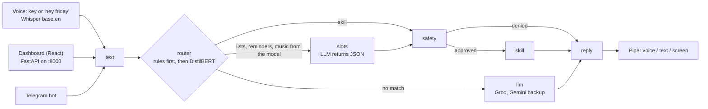

# Friday

A voice-first personal assistant for Windows. Hold a key (or, if you turn the wake word on, say "hey friday"), speak, and Friday answers out loud. Speech recognition (Whisper), the voice (Piper), a small trained intent router and document search run on the laptop; chat answers come from Groq, with Gemini as backup. It also has a web dashboard and a Telegram bot.

It is a one-person project, measured on one laptop. Every measured number below comes from a file in this repo, except the test count (run by hand) and the Telegram check (done by hand, 16 Oct 2026). Sample sizes are next to the numbers.

## Demo

[video link coming]

## What it can do

Echo, clock (time and date), lists and notes, calculator, timers and reminders, Spotify control (play, pause, next, volume), questions about documents you give it (PDF, text, Markdown), and plain chat. The graph has an approval step for risky skills, but no current skill uses it (clearing a whole list is not supported yet). Every step of every turn is saved to a local SQLite trace and shown live in the dashboard.

## Architecture



The nodes are the ones in `friday/graph.py`: router, slots, safety, skill, llm, reply. Rules are tried first. If no rule matches and the trained router model is loaded, it guesses the kind of command. The LLM is the last step. Each node writes a trace row.

The router model is on by default. `FRIDAY_ROUTER_MODEL=0` turns it off (details in `docs/phase6_results.md`, update line at the top).

## Results

Small samples, one speaker, one laptop. Read the n column and the caveats.

### Router model (DistilBERT, shipped model `router_v2`, run B)

| Measure | Result | n | Caveat |
|---|---|---|---|
| MASSIVE en-US test accuracy, 5 classes (run B) | 0.9654 | 2974 test rows | one seed, hyperparameters not tuned |
| Baseline (TF-IDF + logistic regression), same split | 0.9519 | 2974 | `training/finetune_results.md` |
| Own phrasing, held-out lines | 0.8556 (77/90) | 90 lines, 9 to 19 per class | one seed; approximate 95% interval 77% to 91%; typed lowercase text, not Whisper output; some train and test lines are close paraphrases, so it may be optimistic |
| Own phrasing, control without own data (run A) | 0.6889 (62/90) | 90 | same lines |

Source: `training/own_phrasing_results.md`, `training/finetune_results.md`. Speed on the laptop CPU: mean 38.1 ms per line, median 36.0, p95 61.9 (270 timed runs; `docs/router_cpu.md`). The router model was not tuned on real voice data.

### Command evals (live LLM, one sample per row)

A row passes only if routing, reply and database effect are all right. Chat rows are scored on routing only.

| Set | Router OFF | Router ON | Caveat |
|---|---|---|---|
| eval_100, final run (`eval_100_final_live*.md`) | 91/100 | 96/100 | **development set**: fixes were made against it, so it is not held-out |
| Typed held-out #2 (`eval_100_heldout2_off2.md`, `eval_100_heldout2_on.md`) | 26/30 | 29/30 | written before running; typed, not spoken |
| Spoken held-out #2, scored (`eval_100_spoken2_*.md`) | 20/30 | 24/30 | Whisper base.en on the recorded clips; one speaker, read from a screen, no wake phrase |
| Spoken held-out #2, by eye (`docs/p704_spoken_by_eye.md`) | 18/30 | 22/30 | scored number minus two rows that play the wrong song because Whisper misheard; judged by reading the saved transcripts, not by a second scorer |

Typed held-out #2 was run once with the router OFF and cut short by provider errors; the complete re-run is the one quoted. Fixes were made earlier against held-out set #1, so set #1 is not used as a held-out result here.

### Router stats

Counts from `docs/p704_stats.md` (made from the stored result files). Every turn ends in exactly one category. A = finished by a rule action, Docs = docs skill (rule, with an LLM call inside the skill), B = answered by the model + slot extraction, C = "say it again" (C1 + C2), D = plain chat LLM.

| Set | Router | A | Docs | B | C | D | Turns with no LLM call at all | Rows the model was consulted on |
|---|---|---|---|---|---|---|---|---|
| eval_100 (development set, n = 100) | OFF | 69 | 7 | 0 | 10 | 14 | 79 of 100 | not applicable |
| eval_100 | ON | 69 | 7 | 6 | 7 | 11 | 71 of 100 | 24 of 100 |
| Typed held-out #2 (n = 30) | OFF | 23 | 0 | 0 | 2 | 5 | 25 of 30 | not applicable |
| Typed held-out #2 | ON | 23 | 0 | 3 | 0 | 4 | 23 of 30 | 7 of 30 |
| Spoken held-out #2 (n = 30) | OFF | 18 | 0 | 0 | 4 | 8 | 22 of 30 | not applicable |
| Spoken held-out #2 | ON | 18 | 0 | 5 | 2 | 5 | 19 of 30 | 12 of 30 |

- A row that never reached the chat LLM is not the same as a correct action. Spoken, router ON: 25 of 30 rows never reached the chat LLM, but only 20 of those 25 passed. Rows that never reached the chat LLM can still have made a slot call, which is why that number (25) is higher than "no LLM call at all" (19).
- eval_100 is a development set (fixes were made against it).
- The model's extra work is a slot-extraction LLM call: one for each B row (6, 3 and 5). Some "say it again" rows made one too (C2 rows in the ON runs: 5 of 6 in eval_100, 1 of 2 in spoken #2).
- These are counts of how turns ended, not a measure of cost or of calls saved.

### Latency

(a) Voice-to-voice, `docs/latency.md`, 11 Oct 2026: n = 20 runs, mean 2318 ms, median 2210, p95 2877 (nearest rank). Measured from key release to the first reply sentence ready to play, **before the graph, music and RAG were added**. It excludes audio-device and Bluetooth delay.

(b) Full turn, `docs/p703_full1.md`, 18 Oct 2026: saved clip, speech to text, graph, synthesis to a WAV in memory. **No playback**, so it does not end at sound from the speaker. n = 26 turns per mode:

| Router | median | p95 |
|---|---|---|
| OFF | 1300 ms | 2514 ms |
| ON | 1292 ms | 2498 ms |

Chat answers depend on the network and the provider at that minute. The clips are the owner's voice on this laptop. The clips are mostly rule-handled commands, so this is not an LLM-heavy mix.

### Memory (RAM)

- One Python process with Whisper, Piper, the embedder, the router model and the wake word loaded: peak working set 1456 MiB (`docs/p703_full1.md`; machine has 7881 MiB RAM).
- `docs/ram.md` (11 Oct 2026) is a different measure: whole-system RAM read by eye from Task Manager with the voice loop only; peak in use 6.3 GB of 7.7 GB.
- The launcher with API, dashboard and voice running together has **not been measured**.

### Wake word "hey friday"

Both results always go together:

- Offline: 0 false accepts in 7.00 h of a fresh overnight recording (threshold 0.9), and 14/14 recall on 14 fresh clips (`docs/wakeword_decision.md`).
- Live, with Friday running and music and speech playing from a speaker: **5 events in 71.8 minutes, 4.18 per hour, 95% interval 1.36 to 9.74** (`docs/phase6_results.md`). The cause was not found because the audio was not saved.

One speaker, one laptop microphone, one set of rooms. The wake word is off by default (`FRIDAY_WAKEWORD=1` turns it on); push-to-talk always works.

### Document questions (RAG mini eval)

`evals/results/rag_eval_results.md`: 3 small documents, 20 questions (16 answerable, 4 not in the documents), automatic text matching.

| Setting | All correct | Notes |
|---|---|---|
| 500-word chunks (production) | 20/20 | 16/16 answers, 4/4 refusals |
| 40-word chunks (stress) | 18/20 | 2 answerable questions missed: one wrong answer, one wrongly refused |

### Tests

769 tests passed on 18 Oct 2026 (`python -m pytest -q`).

## How to run

### What you need

- Windows 11 (developed and measured only here). Python 3.13 (3.13.3 was used for every measurement; other versions are untested). Node 20.19+ or 22.12+ for the dashboard. A microphone for voice.
- A Groq API key (required). A Gemini key is optional (backup).
- **No model weights are in this repo.** See "Models" below.

### Install

```
python -m venv .venv
.venv\Scripts\activate
pip install -r requirements.txt
copy .env.example .env
cd dashboard
npm install
cd ..
```

Then put your own keys into `.env`. The names are in `.env.example`:

- `GROQ_API_KEY` (required), `GEMINI_API_KEY`
- `TELEGRAM_BOT_TOKEN`, `TELEGRAM_CHAT_ID`
- `SPOTIPY_CLIENT_ID`, `SPOTIPY_REDIRECT_URI`, `SPOTIFY_DEVICE_NAME`

Never commit `.env` or the `.secrets/` folder (both are git-ignored).

### Models

- **Router model** (`models/router_v2`): optional. Without it Friday uses rules + the LLM and prints one log line. The training scripts are in `training/`; the weights are not published.
- **Voice** (Piper `en_US-amy-medium`): download the `.onnx` and `.onnx.json` files from https://huggingface.co/rhasspy/piper-voices/tree/main/en/en_US/amy/medium and put both in `models/`. It is one of the voices published by the Piper project.
- **Whisper `base.en`** and **MiniLM** (`all-MiniLM-L6-v2`) are downloaded by their libraries on first use.
- **Wake word** (optional): needs `models/wakeword/variants/ww_B.onnx`, which is not in the repo, plus two openWakeWord resource files (`melspectrogram.onnx` and `embedding_model.onnx`) that Friday does not fetch for you. Turn it on with `set FRIDAY_WAKEWORD=1` before starting.

### Start everything

```
python scripts\launch.py
```

Flags: `--no-api`, `--no-dashboard`, `--no-voice`. It checks ports 8000 and 5173 first and stops if either is in use (it never kills other programs). API and dashboard output goes to `data\logs\`. Ctrl+C stops everything it started. The dashboard is at http://127.0.0.1:5173 (tabs: Chat, Trace, Results). Hold Right Ctrl, speak, release.

### Start each part alone

| Part | Command |
|---|---|
| API | `python -m uvicorn friday.api.app:app --host 127.0.0.1 --port 8000` (there is no login, keep it on 127.0.0.1) |
| Dashboard | `cd dashboard`, then `npm run dev` |
| Voice | `python -m friday.voice.loop` |
| Telegram | `python -m friday.channels.telegram_bot` (`--find-chat-id` once, to get your chat id) |

### Spotify

Needs Spotify Premium, your own Spotify developer app (client id and redirect URI in `.env`), and the Spotify desktop app open on the laptop. Set `SPOTIFY_DEVICE_NAME` to that device's name: Friday plays only there and never falls back to another device. Log in once with `python scripts\spotify_spike.py` (it saves a token in `.secrets/`; the spike plays one song when it runs).

### Telegram

Create a bot with Telegram's BotFather, put the token in `.env`, send the bot a message, run `python -m friday.channels.telegram_bot --find-chat-id`, add the printed chat id to `.env`, then start the bot. It answers only that chat. Text and voice notes both worked from an iPhone (checked by hand, 16 Oct 2026). Reminders and music are not available on Telegram or on the dashboard; they work only in the voice app.

## Project layout

| Folder | What is in it |
|---|---|
| `friday/` | the graph, router, skills, RAG, voice loop, API, Telegram channel |
| `dashboard/` | React + Vite web dashboard (chat, trace, results) |
| `training/` | router and wake-word training scripts and their result notes |
| `evals/` | command sets, eval runner, result files, sample documents |
| `scripts/` | launcher, measurement and stats scripts |
| `docs/` | measured notes: latency, RAM, wake word, router stats, security sweep |
| `tests/` | the test suite |

## Known limitations

- **Wake word:** false triggers when music or speech plays from a speaker: 4.18 per hour live (5 events in 71.8 min, 95% interval 1.36 to 9.74), next to 0 false accepts in 7.00 h offline on a fresh overnight recording. Always read the two together.
- **Recording without a key press:** a recording sometimes starts without a key press. The cause is unknown and no rate was measured. The speech detector drops empty clips, but noise can still become a junk turn.
- **Whisper mishears names and numbers.** In the spoken set, "eggs" was heard as "x" and "grocery" as "glossary", and two music requests played the wrong song (see `docs/p704_spoken_by_eye.md`).
- **One speaker, one microphone, one room, one laptop.** Other voices, rooms and machines are untested.
- **No approval flow yet.** The approval step exists in the graph and is tested, but no skill uses it, and there is no way to approve by voice, dashboard or Telegram.
- **Windows only.**
- **RAM of the full stack is not measured** (API, dashboard and voice together).
- **Router misses:** in the own-phrasing test all 4 unit-conversion lines and 5 of 14 document questions that avoid the word "document" were wrong (`training/own_phrasing_results.md`).
- **Internet needed** for chat answers; the free-plan limits of the LLM providers are in `docs/limits.md`.

## Security

- Pattern sweep over all history (114 commits): 0 hits for 8 key formats; gitleaks 8.30.1: 115 commits scanned, no leaks found (`docs/p709_security_sweep.md`). A scan is not proof that nothing is hidden anywhere.
- `.env` and `.secrets/` are git-ignored. The API binds to 127.0.0.1 and has no login.
- The repo is public and the commits show the author's personal email address (accepted).

## Licences

- Friday's own code: MIT, see `LICENSE`.
- Third party, facts only, no legal conclusions:
  - LibriTTS-R is licensed CC BY 4.0 (OpenSLR 141 page). In the wake-word training, a Piper voice model named `libritts_r` was used to generate the synthetic "hey friday" clips.
  - ACAV100M precomputed features (Hugging Face dataset `davidscripka/openwakeword_features`): the dataset card says cc-by-nc-sa-4.0 (card read 18 Oct 2026; the original ACAV100M site was not checked). Used only as extra negative training audio. The trained wake-word model is not in this repo.
  - FMA tracks (used as background noise in wake-word training) have their own licences.
  - Other models and libraries (Whisper, Piper, MiniLM, DistilBERT, openWakeWord, and the packages in `requirements.txt`) keep their own licences.

## What is next

Ideas only, none is promised:

- Save the audio at each wake-word trigger to find the cause of the false triggers (`docs/phase6_results.md`).
- More unit-conversion and "file/it" document phrasings for a retrain, scored on a fresh test set (`training/own_phrasing_results.md`).
- Hand-label real Whisper transcripts as an extra router check.
